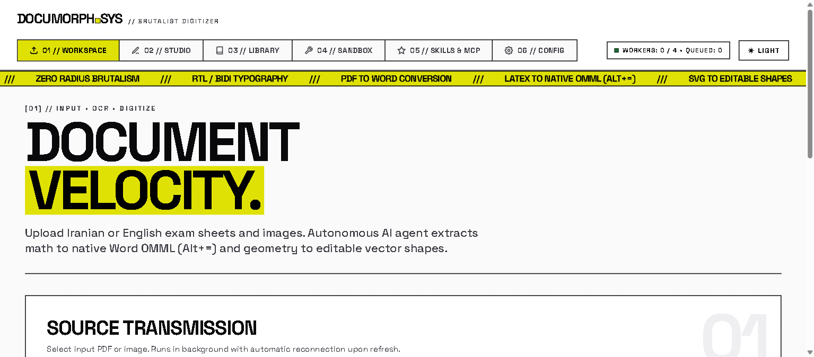
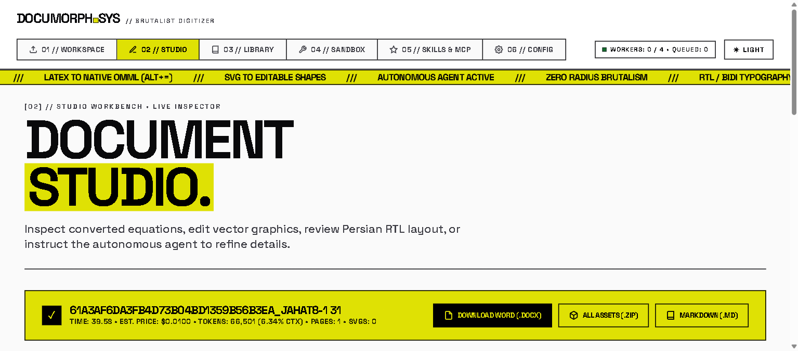

# داکیومورف (DocuMorph AI)

تبدیل هوشمند فایل‌های PDF و تصاویر برگه آزمون به اسناد مایکروسافت ورد (`.docx`) با فرمول‌های ریاضی کاملاً بومی و قابل ویرایش (`OMML` / `Alt+=`) و شکل‌های برداری مستقیم SVG با قابلیت تبدیل به آبجکت در آفیس (Convert to Shape).

[English](README.md) • [راهنمای فارسی](README.fa.md)

---





---

## قابلیت‌های کلیدی

- **معادلات بومی مایکروسافت ورد**: تمامی فرمول‌های ریاضی و فیزیک نوشته شده با LaTeX (`$فرمول$` و `$$فرمول$$`) مستقیماً به قالب ریاضی استاندارد ورد یعنی OMML (`oMath`) تبدیل می‌شوند و با کلید میانبر `Alt+=` در محیط Word کاملاً قابل تغییر و ویرایش هستند.
- **اشکال برداری SVG با امکان تبدیل به Shape در ورد**: فایل‌های SVG بدون افت کیفیت به عنوان وکتور واقعی با استفاده از تکنولوژی `asvg:svgBlip` همراه با تصویر پشتیبان با رزولوشن بالا در فایل `.docx` جایگذاری می‌شوند. در ورد با راست‌کلیک روی تصویر و زدن گزینه **Convert to Shape** (تبدیل به شکل)، کل نمودار یا بردار به خطوط و اشکال قابل ویرایش آفیس تجزیه می‌شود.
- **عامل خودمختار هوش مصنوعی (AI Agent)**: عامل چندمرحله‌ای با قابلیت فراخوانی ابزارها (`agent.py`) که صفحات رندر شده را بررسی نموده، خطاهای نگارشی لاتک و ساختار XML اس‌وی‌جی را بررسی و تصحیح کرده، مهارت‌های تخصصی را لود کرده و در نهایت خروجی DOCX را تولید می‌کند.
- **لاگ گام‌به‌گام عملکرد عامل (Steps)**: مشاهده مرحله به مرحله عملکرد عامل هوش مصنوعی (مشاهده تصاویر صفحات، لود مهارت‌ها، فراخوانی ابزارهای اعتبارسنجی، اصلاح کد مارک‌داون و ساخت سند).
- **سیستم مهارت‌های اختصاصی (Skills Engine - `skills.py`)**: شناسایی و بارگذاری خودکار دستورالعمل‌ها از پوشه محلی `skills/` و مهارت‌های عمومی سیستم (`~/.agents/skills`) نظیر `math-formula-extractor`، `svg-diagram-architect`، `page-layout-architect`، `persian-rtl-typesetter` و `table-and-matrix-styler`.
- **یکپارچگی با پروتکل استاندارد ابزارهای هوش مصنوعی (MCP - Model Context Protocol)**: اتصال به انواع سرورهای محلی (Stdio) یا شبکه (HTTP/SSE) بر پایه استاندارد رسمی JSON-RPC 2.0. ابزارهای شناسایی شده به طور پویا به توابع مدل تبدیل می‌شوند. همچنین دارای سرور داخلی `doc_utils` با ابزارهای تحلیل فرمول‌های ریاضی و دیکشنری اصطلاحات علمی.
- **پایگاه داده SQLite پایدار (`documorph.db`)**: ذخیره تاریخچه مکالمات، فایل‌های تبدیل شده، تنظیمات کلید و آدرس API، سرورهای MCP و صف پردازش‌ها.
- **مدیریت کش و پاکسازی با یک کلیک**: دکمه اختصاصی در بخش تنظیمات برای حذف فایل‌های آپلود شده ورودی، خروجی‌های موقت و پاکسازی جداول دیتابیس با حفظ تنظیمات کاربر.
- **کرنومتر زنده و تخمین هزینه (Timer & Price Calculation)**: تایمر دقیق مدت‌زمان اجرای پردازش‌ها و محاسبه آنلاین هزینه دلاری توکن‌ها بر اساس نرخ رسمی مدل‌های مختلف (Gemini Flash، Claude Opus، Claude Sonnet و غیره).
- **صف پردازش موازی چندفایلی (Parallel Queue)**: امکان انتخاب و آپلود همزمان چند فایل با تفکیک وظایف بین ورکرها در پس‌زمینه تا سقف تنظیم شده (`MAX_CONCURRENT_JOBS`).
- **اجرای پس‌زمینه بدون قطعی**: پردازش در رشته‌های مجزای سرور انجام می‌شود؛ رفرش کردن صفحه مرورگر یا بستن تب، روند تبدیل را متوقف نکرده و با بازگشت به صفحه اتصال از طریق Server-Sent Events (SSE) برقرار می‌گردد.
- **کشف پویای مدل‌ها و تلکتری پیشرفته پنجره کانتکست (Context Window Telemetry)**: دریافت خودکار فهرست مدل‌ها از سرور هوش مصنوعی همراه با ظرفیت کانتکست، تفکیک نواری توکن‌های ورودی (Prompt) و خروجی (Completion)، نشانگرهای درصد و کارت‌های وضعیت زنده.
- **تایپوگرافی سازگار با زبان فارسی و عربی (RTL)**: تشخیص خودکار جهت متن، راست‌چین کردن پاراگراف‌ها، چینش راست‌به‌چپ جداول و حفظ هماهنگی اعداد و متون فارسی در کنار عبارات ریاضی انگلیسی.
- **طراحی بصری بر پایه متریال ۳ گوگل و بروتالیسم کینتیک**: رابط کاربری پیشرفته، بدون انحنا (Zero Radius) با کنتراست رنگی مطابق استاندارد WCAG 2.1 AAA در هر دو حالت روز (Light) و شب (Dark).
- **پاکسازی اضافات AI**: جلوگیری از درج توضیحات اضافی یا بخش‌های زائد مثل «Visual Descriptions» در انتهای سند.

---

## معماری پردازش

```
PDF / تصویر ورودی
    │
    ▼ (pypdfium2 / Pillow)
رندر صفحات با کیفیت بالا (PNG)
    │
    ▼ (Vision API / مدل‌های چندحالته هوش مصنوعی)
استخراج مارک‌داون + لاتک + بردار SVG
    │
    ▼ (ابزارهای عامل: validate_latex, validate_svg, edit_markdown_snippet)
مارک‌داون تایید شده و استاندارد
    │
    ▼ (converter.py)
┌────────────────────────────────────────────────────────┐
│  • تبدیل LaTeX به MathML و سپس OMML بومی (MML2OMML.XSL)│
│  • تبدیل SVG به DrawingML با سازگاری ورد ۲۰۱۶ به بعد   │
│  • تنظیم جهت RTL/LTR پاراگراف‌ها و جداول               │
└────────────────────────────────────────────────────────┘
    │
    ▼
پوشه خروجی: اسناد .docx + سورس .md + فایلهای .svg + آرشیو .zip
```

---

## پیش‌نیازها

- **پایتون نسخه ۳.۱۳ یا بالاتر** (`py -3.13` در ویندوز)
- برنامه مایکروسافت ورد (Microsoft Word برای باز کردن و ویرایش اسناد `.docx`)

### نصب وابستگی‌ها

```bash
pip install -r requirements.txt
```

---

## تنظیمات محیطی (`.env`)

یک فایل با نام `.env` در ریشه پروژه با مقادیر مد نظر خود بسازید:

```env
OPENAI_API_BASE_URL="http://localhost:20128/v1"
OPENAI_API_KEY="your-api-key"
AI_DEFAULT_MODEL="ag/gemini-3.8-flash-high"
OUTPUT_PATH="D:\arush\toword\output"
```

---

## نحوه اجرا و استفاده

### ۱. اجرای رابط وب داشبورد

با استفاده از لانچر آماده:
```bat
run.bat
```

یا مستقیماً با دستور پایتون:
```bash
py -3.13 app.py
```
سرور روی آدرس `http://localhost:8000` بالا آمده و مرورگر به صورت خودکار باز می‌شود. قابلیت بارگذاری خودکار تغییرات کد (Auto-Reload) به صورت پیش‌فرض فعال است.

سوئیچ‌های خط فرمان:
- `--port 8000`: تنظیم درگاه پورت دلخواه.
- `--no-reload`: غیرفعال کردن ریلود خودکار فایل‌ها.
- `--no-browser`: جلوگیری از باز شدن خودکار مرورگر.

### ۲. تبدیل مستقیم از ترمینال (CLI)

اجرای پایپ‌لاین پیشرفته به همراه عامل خودمختار:
```bash
py -3.13 app.py input/document.pdf --mode agent
```

اجرای پایپ‌لاین سریع تک‌مرحله‌ای:
```bash
py -3.13 app.py input/document.pdf --mode fast
```

### ۳. بررسی صحت کد و تست‌های خودکار

اجرای ۱۴ تست خودکار برای تضمین عملکرد OMML، جاسازی وکتورهای SVG در ورد، جهت متون فارسی، مهارت‌های عامل، پروتکل MCP، فرمول‌های فاصله‌دار لاتک (`\qquad`)، اعتبارسنجی Ruff و تلکتری توکن‌ها:
```bash
py -3.13 test_check.py
```

بررسی و فرمت‌بندی کد با استفاده از ابزار سریع Ruff:
```bash
# بررسی خطاهای نگارشی و استاندارد کد
py -3.13 -m ruff check .

# اصلاح خودکار خطاهای قابل رفع
py -3.13 -m ruff check --fix .

# فرمت‌بندی خودکار فایل‌های پایتون
py -3.13 -m ruff format .
```

---

## مهارت‌ها و ابزارهای پروتکل MCP

### مهارت‌های موجود (Skills)
مهارت‌ها در پوشه `skills/` به صورت ماژولار تعریف شده‌اند:
- `math-formula-extractor`: قوانین دقیق فرمول‌های چندخطی، ماتریس‌ها و توابع کسری برای سازگاری کامل با OMML آفیس.
- `svg-diagram-architect`: قواعد رسم وکتور، تعبیه viewBox و ویژگی‌های هندسی جهت تجزیه بدون نقص به شکل‌های ورد.
- `page-layout-architect`: بازسازی صحیح صفحات امتحانی بدون قرار دادن کل صفحه داخل جدول (با حفظ سربرگ، نمرات و شماره‌گذاری).
- `persian-rtl-typesetter`: قوانین راست‌چین، شماره‌گذاری سوالات فارسی و متون دوزبانه.
- `table-and-matrix-styler`: استانداردسازی جداول داده واقعی و چینش ماتریس‌ها.

عامل هوش مصنوعی با ابزار `use_skill(skill_name)` این مهارت‌ها را فراخوانی می‌کند و کاربر نیز در محیط استودیو می‌تواند با دکمه‌های کپسولی سریع مهارت‌ها را به فرآیند بازبینی اضافه کند.

### اتصال به سرورهای پروتکل MCP
داکیومورف می‌تواند به ابزارهای جانبی متصل شود:
1. **فرآیند Stdio**: اجرای دستورات شل و CLI (نظیر دستورات npx یا پایتون).
2. **ارتباط شبکه HTTP / SSE**: اتصال به سرورهای راه‌دور JSON-RPC.
3. **سرور داخلی `doc_utils`**: ابزارهای بومی `analyze_math_formulas`، `generate_svg_grid` و `math_term_dictionary`.
4. **سندباکس تست MCP**: قابلیت اجرای زنده و آزمایش ابزارهای MCP در تب `04 // SANDBOX`.

---

## ساختار فایل‌های خروجی

کلیه نتایج تبدیل در پوشه `output/` سازمان‌دهی می‌شوند:
- `<شناسه>_<نام‌فایل>.docx`: فایل ورد حاوی فرمول‌های OMML بومی و اشکال وکتور.
- `<شناسه>_<نام‌فایل>.md`: فایل مارک‌داون پاکسازی‌شده.
- `<شناسه>_<نام‌فایل>_svgs/`: پوشه محتوی فایل‌های وکتور SVG استخراج‌شده به صورت مجزا.
- `<شناسه>_<نام‌فایل>_bundle.zip`: بسته فشرده تجمیعی قابل دانلود شامل فایل ورد، مارک‌داون و اشکال.

---

## مجوز (License)

پروژه تحت پروانه انتشار متن‌باز [MIT License](LICENSE) عرضه شده است.
